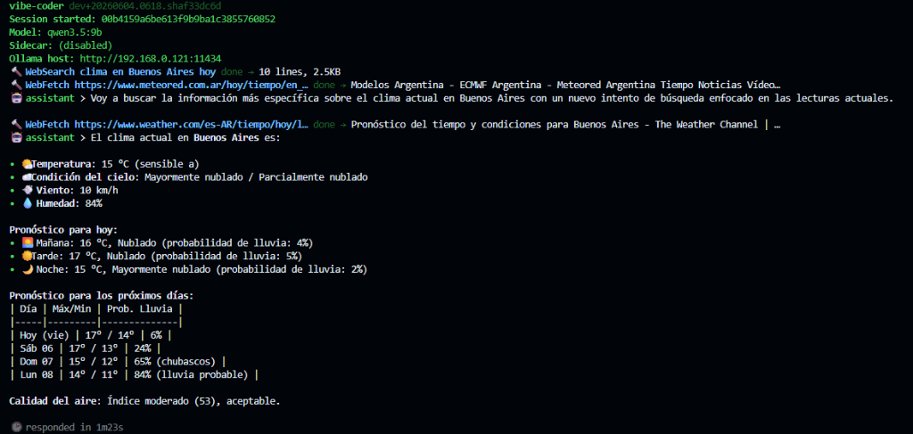

<p align="center">
  
</p>

<h1 align="center">vibe-coder</h1>

<p align="center">
  <strong>A local-first coding agent for <a href="https://ollama.com">Ollama</a>, written in Go.</strong>
</p>

<p align="center">
  Ships as a single static binary named <code>vibe</code> — one-shot prompts, an interactive REPL,
  a rich tool system, session persistence with compaction, and optional RAG, all without leaving your machine.
</p>

<p align="center">
  <a href="https://github.com/jonathanhecl/vibe-coder/releases/latest"></a>
  <a href="https://github.com/jonathanhecl/vibe-coder/actions/workflows/ci.yml"></a>
  
  
  <a href="LICENSE"></a>
  
</p>

<p align="center">
  
</p>

## Contents

- [Features](#features)
- [Requirements](#requirements)
- [Install](#install)
- [Quick Start](#quick-start)
- [Model Configuration](#model-configuration)
- [CLI Flags](#cli-flags)
- [MCP & Skills Management CLI](#mcp--skills-management-cli)
- [Slash Commands](#slash-commands)
- [Vision](#vision)
- [RAG Usage](#rag-usage)
- [Development](#development)
- [Architecture Overview](#architecture-overview)
- [Contributing](#contributing)
- [Security](#security)
- [License](#license)

## Features

### Core agent

- **One-shot prompts** (`-p`) and **interactive REPL** with streaming output.
- **Multi-turn agent loop** (up to 50 iterations, 2 retries) with tool observation feedback.
- **Native tool calling** — registry schemas are sent as Ollama `tools`; capability is detected from `/api/tags`, with a `/api/show` probe when tag metadata is missing (`Tools: native|xml|auto` in `/status`), plus per-session 400 fallback and caching. Streamed calls are accumulated across chunks, and native turns replay structured history (`assistant.tool_calls` + role `tool` results) instead of text envelopes.
- **Batched tool calls** — up to 5 sequential calls per turn (native or `<invoke>` XML fallback) for independent calls.
- **Empty-response recovery** — retries with escalating guidance when the model returns an empty reply.
- **XML fallback parser** — kept for models without native function calling; native calls always win when present.
- **Verify-after-write** — after every `Write`/`Edit`, the agent Reads the edited region and runs the relevant check before moving on.
- **Autonomous missions (agent-managed)** — for work that outlasts a single reply, the agent can call `MissionStart` to declare a mission. The runtime then keeps starting turns for it, with **no turn limit**, until the agent itself calls `MissionComplete` (goal done) or `MissionBlocked` (needs the user). The mission is task-agnostic and needs no user command to activate.
- **Durable work state** — the mission, live TODO checklist, and task store are persisted in a session sidecar and restored on `--resume`/`/session`, so a crash or restart never loses what is done and what remains. A compact progress summary derived from that state is injected into the system prompt every turn, so compaction can never make the agent forget what is done or what remains.
- **Auditable run log** — each autonomous turn appends one redacted JSONL record (turn, mission status, checklist counts, tools used, error) to `<state dir>/runs/<session>.jsonl`, so a multi-hour run can be reviewed after the fact.

### Autonomous missions

Some work does not fit in one reply: a batch of hundreds of items, a migration,
or an iterative generate-and-check loop that runs for hours. For those, the
agent itself decides to run a **mission**:

1. It calls `MissionStart` with the user's goal and opens a `TodoWrite`
   checklist.
2. The runtime keeps starting new turns for it (`[mission] continuing
   autonomously`) after each per-turn iteration cap — with **no turn limit**.
3. The agent ends the mission itself: `MissionComplete` with a summary when the
   goal is done, or `MissionBlocked` with a reason when it needs the user.

You can initiate an autonomous mission directly with `/goal <objective>` (or
`/mission start <goal>`), or let the agent declare one itself via `MissionStart`.
When started with `/goal`, the agent follows a phased protocol: Phase 1 plans the
step-by-step approach and verification strategy via `TodoWrite` (clarifying any
ambiguities with `AskUserQuestion`), and Phase 2 executes the plan autonomously.
You can also inspect and end one from your side with `/mission`:
`/mission` shows the mission (goal, status, turns), `/mission done [summary]`
marks it complete (for example when you did the work yourself), and
`/mission cancel [reason]` stops it without completing. While a mission is
active the run is **unattended**: Ask and
Network tools are auto-approved so nothing blocks waiting for the user, while
mandatory dangerous-command confirmations are denied (never prompted) so the
agent gets a denial and can adapt or call `MissionBlocked`. Empty responses are
retried automatically and, if they persist, or if several turns run no tools at
all, the mission is paused instead of spinning. The mission, checklist, and tasks
are written to disk after every turn, so `--resume` continues an interrupted
mission exactly where it stopped and tells you a mission is waiting. `/status`
shows the current mission, and every turn is appended to the redacted run log at
`<state dir>/runs/<session>.jsonl` for auditing.

### Tools (exposed to the model)

- **File ops**: `Read`, `ReadMany`, `Write`, `Edit` (with inline unified-diff preview in the TUI).
- **Search**: `Glob`, `Grep` (multiline, context lines, output modes).
- **Shell**: `Bash` and `InteractiveBash` with dangerous-command blocklists and protected-path guards.
- **Web**: `WebFetch` and `WebSearch` (DuckDuckGo scrape) with SSRF protection: private hosts are rejected up front, every redirect target is re-validated (max 5 hops), connections are pinned to publicly resolved addresses (DNS-rebinding guard), and requests respect cancellation.
- **HTTP**: `HTTPRequest` — a generic `method`/`url`/`headers`/`body` request tool for REST/JSON APIs, including local services (it allows localhost, unlike `WebFetch`). Network-tier, domain-agnostic, and the reliable alternative to shelling out to `curl`.
- **Notebook**: `NotebookEdit` for `.ipynb` JSON round-trip.
- **Tasks**: `TodoWrite` (live to-do panel), `TaskStart`, `TaskList`, `TaskComplete`, `TaskCancel`.
- **Missions**: `MissionStart` (declare a long-running goal and hand the runtime control), `MissionComplete` (goal done), `MissionBlocked` (needs the user).
- **Questions**: `AskUserQuestion` for interactive multi-choice prompts.
- **Orchestration**: `SubAgent` (bounded ReAct loop over Read/Glob/Grep, opt-in writes) and `ParallelAgents` (explicit model calls only).
- **Git**: `GitStatus`, `GitDiff`, `GitUndo` (restore the latest vibe-coder checkpoint).
- **All file-search tools** skip heavy directories (`.git`, `node_modules`, `vendor`, etc.) and respect cancellation.

### Session management

- **Atomic persistence** — append-only JSONL with temp-file + rename (`0o600`).
- **Project-aware indexing & auto-resume** — sessions are keyed by `sha256(cwd)[:16]` so running `vibe` automatically resumes where you left off in that directory (tagged as `(resumed)` in the banner). Use `/new` or `-n`/`--new` to start fresh.
- **Temporal (ephemeral) sessions** — run with `-t`, `--temporal`, or `--temp`. Nothing is written anywhere: the chat transcript, the metrics, the log, the mission run log, and the user-level directories are all skipped, so the run leaves no trace (tagged as `(temporal)` in red in the banner). Files and code modifications made by the agent remain intact, settings still go to the shared config file, and the RAG index is kept in memory. Running `/promote` within a temporal session keeps it by promoting it to permanent.
- **Isolated sessions** — run with `--isolated` or `--isolate` (or configured via `VIBE_CODER_ISOLATED=true` or `ISOLATED=true`). The run keeps the records it saves inside the current folder: `.vibe-isolated.jsonl` (transcript), `.vibe-isolated-history.txt` (prompt history), `.vibe-isolated-media/`, and `.vibe-isolated-rag.db`. It records no metrics and no log, creates no user-level state directory, and other directories cannot access it; the settings (models, providers, `SIDECAR_DISABLED`, remembered tool permissions) still go to the shared config file, so they apply to every mode. Running `vibe` in a directory containing an isolated session automatically detects and loads it (tagged as `(isolated)` in yellow in the banner). Running `/new` resets the isolated session — the file keeps only its marker line, so the folder keeps detecting the mode — and `/sessions delete` only reaches the folder-local session. `/save` writes the transcript into the folder and reports that the session stays isolated there.
- **Compaction** — triggered at 300 messages or 70 % of context window; a sidecar model (falling back to the primary model when unconfigured) summarizes the oldest messages while keeping the last 30 verbatim.
- **Token estimate** — maintained incrementally so compaction checks are O(1).

### Safety and permissions

- **Three permission tiers**: Safe (allow unless denied), Ask, and Network (prompt unless approved by a remembered rule or `-y`). Persistent denials apply to safe tools too.
- **The prompt has a clock**: the permission card prints a `⏳ 3:00` badge on its input line (`▸ ⏳ 3:00  Select option (1-7) [default: deny]:`) and counts down while it waits. When the clock reaches zero the action is denied as if the user had picked `Deny once` — no session rule is recorded, nothing is executed, and the model is told the prompt timed out so it keeps working on the rest of the task instead of retrying. Configure it with `VIBE_USER_TIMEOUT` (alias `VIBE_CODER_PERMISSION_TIMEOUT`), `PERMISSION_TIMEOUT` or `--permission-timeout` (Go duration, default `3m`; `off` waits forever), or for the session with `/settimeout 5m` plus `/save` to keep it. The countdown appears only when both stdin and stdout are terminals; a piped run keeps the old blocking behavior.
- **Command gravity** — every shell command is classified before it runs, so the permission card shows its weight instead of reading every command alike. `READ` commands only inspect (a pipeline made of readers whose paths all resolve inside the workspace, with `2>/dev/null` allowed and no output redirection), so they run without a prompt and without spending a decision-model round trip. `WRITE` creates or updates files. `DESTRUCTIVE` deletes or overwrites data that already exists, including `cat a > b` over a file that already holds content, `cp a b`/`mv a b` onto an existing file, `>` truncation versus `>>` append, and history-rewriting git commands. `CATASTROPHIC` cannot be undone. The card prints `GRAVITY <level>` plus a one-line reason, and the level is handed to the decision model as runtime context; a model verdict that itself reports `high` risk is never auto-approved, however confident it claims to be.
- **`-y` mode** enables auto-approval except for catastrophic commands in `Bash`, `InteractiveBash` and `BackgroundRun`. Remembered approvals, an approved session rule, and unattended missions cannot bypass them either (a mission denies them instead of hanging on a prompt).
- **In-session memory** — `/yes` and `/no` toggle at runtime; decisions are remembered for the current session.
- **Persistent permissions** — saved as `TOOL_PERMISSIONS` in `vibe-coder.env` (skips `Bash:allow`; legacy `permissions.json` is migrated).
- **Catastrophic commands are always confirmed**: `rm -rf /`, `rm -rf ~`/`$HOME`/`*`/`.`/`..`, a recursive delete of a system root or of the workspace itself, `sudo`/`doas`/`su`, `mkfs*`, `fdisk`, `dd of=/dev/*`, `shutdown`/`reboot`/`halt`, a fork bomb, `curl … | sh`, `> /dev/sd*`, recursive `chmod`/`chown` on a system root, `git push --force`, `git filter-branch`, and `npm`/`cargo publish`. Wrappers cannot launder them: `nice sudo rm -rf /`, `bash -c 'rm -rf /'` and `xargs rm` are judged by the command they run, never by the wrapper name.
- **Dangerous-command blocklist** (`rm -rf /`, `> /dev/sda`, etc.) and **protected-path guard** (`/proc`, `/sys`, `~/.ssh/id_*`, `~/.aws/credentials`, etc.). This is a second, independent layer applied at execution time: the permission gate decides whether to ask, the blocklist refuses outright what an agent has no legitimate reason to run.
- **Environment scrubbing** — shell tools and auto-tests run with `safety.CleanEnv()` to strip secrets.
- **Plan mode** — `/plan` permits read-only tools and session task management; `Write`/`Edit` are restricted to `<cwd>/.vibe-coder/plans/`, without symlink paths. Shell commands, auto-tests, `NotebookEdit`, `GitUndo`, and unknown/MCP tool effects are blocked until act mode resumes.
- **Review mode** — `/review <prompt>` permits read-only tools and session task management, with no file mutations or shell commands. Unknown/MCP tool effects are blocked by default.
- **Offline mode** — `--offline` flag or `/offline` command blocks all network-tier tools (`WebSearch`, `WebFetch`, `HTTPRequest`) and external network shell commands (such as `curl`, `wget`, `git clone`, `npm install`), while permitting loopback/local requests (`localhost`, `127.0.0.1`, `::1`). Shell commands are evaluated by the decision model when active or via regex heuristics.
- **Workspace domain boundary protection** — the directory where `vibe` was started and its subdirectories define the active workspace domain. Safe tools (`Read`, `Glob`, `Grep`, `DescribeImage`) execute prompt-free inside the domain, but reading files, inspecting images, or querying directories outside the domain requires explicit user consent via the permission card. Users can approve once, allow for the session (`Allow this session`), block for the session, or persist (`Always allow` / `Always deny`). User-provided files (such as `/paste` clipboard images) remain authorized. A refusal (`4`, `5`, `6`) refuses only that action: the model receives the denial plus the instruction to work around it, and the run keeps going. Only `Cancel` (`7`) aborts the run and returns to the prompt.
- **Delegated permissions** — sub-agents inherit the parent's tool availability, permission checks, and active mode. `allow_writes=true` only requests access; it does not grant approval. Child tool execution is serialized, including permission prompts, checkpoints, and auto-tests.

### TUI

- **Two UI modes**: `plain` (default, line-based) and `rich` (Bubble Tea + Lipgloss with pinned status bar, themed markdown, and syntax highlighting). Select with `--ui rich`.
- **To-do panel** — `TodoWrite` renders a live Cursor-style task list with status glyphs.
- **Inline diff renderer** — `Edit` tool shows colored unified-diff (red/green/cyan) with 50-line truncation.
- **Type-ahead** — keystrokes pressed mid-generation are captured and prefilled into the next prompt.
- **Multiline input** — dedicated keybinding starts multi-line mode; plain Enter submits.
- **Terminal restoration** — signal handler ensures raw mode is never left behind on Ctrl+C, ESC, or panic.

### Integrations

- **RAG** (optional, `-tags rag`) — SQLite-backed indexing with incremental (content-hash) re-indexing and hybrid retrieval: lexical token overlap fused with embedding cosine similarity (reciprocal rank fusion) when the `embedding` role is bound, lexical-only otherwise. Build with `--rag-index`, query with `--rag`.
- **MCP** — stdio JSON-RPC client that discovers external tools and wraps them as `mcp_<server>_<name>`. Servers start independently and best effort: a broken one is reported and costs only itself. `/mcp` (or the startup block) shows each server's scope, state and tool count, `/mcp tools` lists the wrapped tool names, calls are bounded by a per-call timeout, and output respects the shared tool output cap.
- **Agent Skills on demand** — discovers `SKILL.md` skill folders and flat `.md` files under project, user, and `SKILLS_DIRS` roots; the prompt carries a name+description catalog and the `Skill` tool loads the full content, with read-only access to bundled files.
- **File checkpoint + auto-test** — pre-Edit/Write copies leave the working tree, index, and stashes untouched. A successful changed file becomes a completed checkpoint; failed or unchanged edits do not replace usable undo history. Related tests request shell execution permission, and failures or denied execution are re-injected as `[AUTO-TEST]` observations.
- **Language server diagnostics** — after a successful `Edit`/`Write` the file's language server (gopls, typescript-language-server, rust-analyzer, `ruff server`/`pylsp`) is asked for a report, and the result lands as a `[DIAGNOSTICS]` observation. A fresh error skips the auto-test for that edit: the server answered in milliseconds what the suite would take a minute to say. The read-only `Diagnostics` tool exposes the same report on demand, and `/status` shows which servers resolved.
- **File watcher** — external file changes appear as `[System Note] N file change(s) detected` on the next iteration.

## Requirements

- Go `1.26+` (see `go.mod`)
- A running Ollama instance for model-backed execution

## Install

### Pre-built binaries (recommended)

Download the archive for your OS and architecture from the
[GitHub Releases](https://github.com/jonathanhecl/vibe-coder/releases)
page, extract it, and move the binary to a directory in your `PATH`.

| OS | Architecture | Asset |
|----|--------------|-------|
| Windows | amd64 | `vibe_<version>_windows_amd64.zip` |
| Linux | amd64 | `vibe_<version>_linux_amd64.zip` |
| Linux | arm64 | `vibe_<version>_linux_arm64.zip` |
| macOS | amd64 | `vibe_<version>_darwin_amd64.zip` |
| macOS | arm64 | `vibe_<version>_darwin_arm64.zip` |

Windows PowerShell example:

```powershell
# Download the latest release (replace <version> with the release tag, e.g. v0.1.0)
$version = "<version>"
$url = "https://github.com/jonathanhecl/vibe-coder/releases/download/${version}/vibe_${version}_windows_amd64.zip"
Invoke-WebRequest -Uri $url -OutFile vibe.zip
Expand-Archive -Path vibe.zip -DestinationPath "$env:LOCALAPPDATA\Programs\vibe" -Force
# Add to PATH, e.g. via Environment Variables settings or:
$env:Path += ";$env:LOCALAPPDATA\Programs\vibe"
```

Linux / macOS example:

```bash
# Replace <version> and <os>_<arch> with the desired release and platform
version="<version>"
asset="vibe_${version}_linux_amd64.zip"
curl -LO "https://github.com/jonathanhecl/vibe-coder/releases/download/${version}/${asset}"
unzip "${asset}"
sudo mv vibe /usr/local/bin/
```

### Install with Go

If you have Go installed:

```bash
go install github.com/jonathanhecl/vibe-coder/cmd/vibe@latest
```

Make sure your `GOBIN` or `GOPATH/bin` is in `PATH`.

### Install a development build

From a local clone, use the dev install scripts to build and install with the current Git metadata:

**Linux / macOS:**

```bash
./install-dev.sh
```

**Windows:**

```powershell
.\install-dev.ps1
```

### Build from source

```bash
go build -o vibe ./cmd/vibe
```

Windows:

```powershell
go build -o vibe.exe ./cmd/vibe
```

Verify the install:

```bash
vibe --version
```

## Build

```bash
go build -o vibe ./cmd/vibe
```

Windows:

```powershell
go build -o vibe.exe ./cmd/vibe
```

Helper scripts:

```bash
./run.sh          # build + run with forwarded flags
./release.sh      # cross-compile archives, create a Git tag, and publish a GitHub Release
```

```powershell
.\run.ps1
.\release.ps1
```

On Linux/macOS, publish a release with:

```bash
GITHUB_TOKEN=<token> ./release.sh v1.0.5
```

`release.sh` runs the test suite (unless `--skip-tests`), builds all platform
archives into `dist/`, writes `dist/checksums.txt`, then creates the Git tag and
the GitHub Release and uploads the assets. `--yes` skips the confirmation prompt
for non-interactive use. It needs a token with `repo` scope in `GITHUB_TOKEN`
(or `GH_TOKEN`, or an authenticated `gh` CLI); a zip tool (`zip`, 7z, bsdtar, or
python3) is used for packaging.

The release workflow produces platform archives in `dist/`, then uploads them as assets to the GitHub Release for the requested tag.

## Quick Start

One-shot prompt:

```bash
./vibe -p "Summarize this repository"
```

Interactive mode:

```bash
./vibe
```

Use a specific model and host:

```bash
./vibe --model llama3.1:8b --ollama-host http://127.0.0.1:11434
```

Send an initial prompt and keep chatting:

```bash
./vibe -p "Refactor main.go" -i
```

## Model Configuration

Model settings are loaded with this precedence:

1. defaults
2. config file
3. environment variables
4. CLI flags (highest priority)

Default config file path:

- Windows: `%LOCALAPPDATA%\vibe-coder\vibe-coder.env`
- Linux/macOS: `~/.config/vibe-coder/vibe-coder.env`

You can override the config file path with:

- `VIBE_CODER_CONFIG=<path>`

Model keys and overrides:

- Config file key: `MODEL=<model-name>`
- Config file key: `UI=plain|rich`
- Config file key: `SIDECAR_MODEL=<model-name>`
- Config file key: `DECISION_MODEL=<model-name>`
- Config file key: `DECISION_ENDPOINT=<url>`
- Config file key: `DECISION_API_KEY=<token>`
- Config file key: `ASSISTED_YES=true|false`
- Config file key: `THINK=off|low|medium|high|max`
- Config file key: `PROVIDER_<NAME>_ENDPOINT=<url>`, `PROVIDER_<NAME>_KIND=ollama|openai`, `PROVIDER_<NAME>_API_KEY=<token>` — named provider registry (see [Providers & roles](#providers--roles))
- Config file key: `ROLE_<ROLE>_PROVIDER=<name>`, `ROLE_<ROLE>_MODEL=<model-name>` with `<ROLE>` in `MAIN|SIDECAR|DECISION|EMBEDDING|VISION` — role bindings
- Config file key: `KEEP_ALIVE_MAIN=<seconds>`, `KEEP_ALIVE_WORKER=<seconds>` — how long a role's model stays loaded after a request: `-1` pins it forever, `0` uses the provider default, `N>0` unloads it after `N` idle seconds (defaults: main `-1`, workers `300`)
- Environment: `VIBE_CODER_MODEL=<model-name>`
- Environment: `VIBE_CODER_UI=plain|rich`
- Environment: `VIBE_CODER_SIDECAR_MODEL=<model-name>`
- Environment: `VIBE_CODER_DECISION_MODEL=<model-name>`
- Environment: `VIBE_CODER_DECISION_ENDPOINT=<url>`
- Environment: `VIBE_CODER_DECISION_API_KEY=<token>`
- Environment: `VIBE_CODER_ASSISTED_YES=true|false`
- Environment: `VIBE_CODER_THINK=off|low|medium|high|max`
- Environment: `VIBE_CODER_KEEP_ALIVE_MAIN=<seconds>`, `VIBE_CODER_KEEP_ALIVE_WORKER=<seconds>` — per-role model keep_alive (`-1` pins, `0` provider default, `N` unload after N idle seconds)
- Environment: `VIBE_CODER_TEMPORAL=true|false` (aliases: `VIBEGO_TEMPORAL`, `TEMPORAL`)
- Environment: `VIBE_CODER_ISOLATED=true|false` (aliases: `VIBEGO_ISOLATED`, `ISOLATED`)
- Config file key / environment: `CHAT_TIMEOUT` / `VIBE_CODER_CHAT_TIMEOUT` (Go duration, e.g. `30m`; default `15m`) — deadline for a single `/api/chat` turn, useful for slow local models in long missions
- Config file key / environment: `PERMISSION_TIMEOUT` / `VIBE_USER_TIMEOUT` (alias `VIBE_CODER_PERMISSION_TIMEOUT`; Go duration, e.g. `90s`; default `3m`, `off` waits forever) — how long any prompt that waits on the user runs before deciding for them: a permission prompt denies the action, an `AskUserQuestion` card takes its default
- CLI: `--permission-timeout <duration|off>` — same bound from the command line
- CLI: `--ui plain|rich`
- CLI: `--model <model-name>` (or `-m <model-name>`)
- CLI: `--sidecar <model-name>`
- CLI: `--decision-model <model-name>` — Ollama model with the `decision` capability
- CLI: `--decision-endpoint <url>` — custom System One server (e.g. `http://192.168.0.33:8765`)
- CLI: `--assisted-yes` (auto-approve safe commands via the decision model)
- CLI: `--think <level>` (`off|low|medium|high|max`; explicit levels need a thinking-capable model)
- CLI: `--keep-alive-main <seconds>`, `--keep-alive-worker <seconds>` — per-role model keep_alive (`-1` pins forever, `0` provider default, `N` unload after N idle seconds)

If no model is set, `vibe` auto-selects one based on detected RAM tier.

> **Recommended model**: `ornith:9b` works very well with Ollama for coding and multi-turn tool conversations in `vibe`.
>
> ```bash
> ./vibe --model ornith:9b --ollama-host http://127.0.0.1:11434
> ```

### What is the sidecar model for?

`MODEL` is the conversational/coding model that answers every prompt. The
**sidecar** is a smaller, faster model `vibe` uses internally for
short, high-leverage tasks the main model would either bloat the context
with or answer too slowly. All sidecar calls are guarded by a worker
semaphore, request deduplication (`singleflight`) and a small LRU cache,
so even on a single local Ollama instance you never see N parallel
requests piling up.

The sidecar is invoked in three places today:

1. **Session compaction** — when the session has more than 300 messages
   or the incremental token estimate exceeds 70% of `ContextWindow`,
   `Session.Compact()` sends the oldest messages to the sidecar with a
   "Summarize the conversation concisely" prompt and replaces them with
   the summary. The last 30 messages are kept verbatim.
2. **Tool-output condensation** — when a tool (typically `Read`, `Bash`,
   `Grep`) returns more than ~6 KB, the output is sent to the sidecar
   with a strict "produce 4-10 bullets, preserve paths/symbols/errors,
   no prose" system prompt. The condensed bullets replace the raw bytes
   in the model's context.
3. **Path disambiguation** — when the agent rescues a relative path
   (e.g. `Read("config.go")`) and finds **multiple** known absolute
   candidates, the sidecar picks one based on the user's current goal.

Pick a sidecar that is **fast and cheap** (e.g. `llama3.2:3b`,
`qwen3.5:4b`, `phi3:mini`). Leave it empty to disable all three
behaviours: compaction will truncate to a static "Earlier conversation
truncated…" note, large tool outputs will be inserted verbatim into the
context, and ambiguous paths will not be rescued.

### Fast model (rabbit)

`RABBIT_MODEL` / `ROLE_RABBIT_MODEL` (or use `/setmodel <provider> rabbit <model>`)
is an optional faster model used for read-only retrieval work such as
`SubAgent` searches and batched `ReadMany` lookups. It runs with read-only
tools and a tighter turn/byte budget, then hands the summary back to the
main model.

If the rabbit role is unset, or its provider is unreachable, retrieval falls
back to the sidecar and then to the main model. Pick something small and
fast (the tested target is `lfm2.5-8b-a1b-uncensored` style models);
rabbit is best-effort and falls back rather than failing the task.

### Decision model

`DECISION_MODEL` / `DECISION_ENDPOINT` configure a specialized, **text-only decision function** (not a conversational chat model, vision model, or tool-calling model). The client speaks the **System One protocol** — `POST <endpoint>/v1/systemone` with typed questions (`noul` for yes/no, `choice` for categorical picks, `score` for ordinal scales) — and gets structured answers back with probabilities and confidence. It works against either backend:

- **Native Ollama (>= 0.35)**: any Ollama model that advertises the `decision` capability in `/api/show`. When `DECISION_ENDPOINT` is empty, the configured `DECISION_MODEL` is queried on the main Ollama host.
- **Custom System One server**: a dedicated endpoint such as `jev-style serve` that answers `/healthz` and `/v1/systemone` directly (set `DECISION_ENDPOINT`).

Example Ollama decision-capable models:

```bash
ollama pull nimble
ollama pull tev1
ollama pull clef-flash   # also advertises the vision capability
```

You can test the configured decision model inside the interactive session with `/decision test`.

#### Decision workflows powered by the decision model

When configured, the decision model acts as a fast, discrete decision engine for key agent operations:
1. **Assisted command execution mode (`--assisted-yes`, `/yes assisted`, `/decision assisted on`)**:
   Instead of either prompting on every action or blindly auto-approving everything, the decision model reviews every action that would otherwise prompt — shell commands, network tool calls (`WebSearch`/`WebFetch`/`HTTPRequest`), file mutations (`Write`/`Edit`/`GitUndo`), and unknown/MCP tools. Safe actions are auto-approved; destructive or risky ones prompt the user. Mandatory shell confirmations (`sudo`, `rm -rf /`, …) and persistent denials still apply.
   - **Review notices**: The terminal always reports what assisted mode did, so a permission prompt is never a mystery: `✓ <tool> approved by the decision model (assisted mode) (<latency>)` when approved; `⚠ <tool> flagged as risky by the decision model (<latency>) · asking for permission` when the model rejected it; `⚠ <tool> cannot be classified by the decision model · asking for permission`; and `⚠ decision model unavailable · assisted mode disabled · asking for permission` when the model is missing or errors.
   - **Startup banner status**: When assisted mode is active, the startup banner highlights `(assisted enabled)` in green alongside the configured decision model; when inactive, it displays `(run '/yes assisted' to enable)` in standard white.
   - **Configuration persistence**: Setting assisted mode can be saved across runs in `vibe-coder.env` (`ASSISTED_YES=true`, `/save`, `--save`).
   - **Absence and error fallback**: If no decision model is configured or if it experiences network or inference errors, assisted mode automatically deactivates and safely reverts to standard user confirmation prompts (`AskPermission`).
   - **Setup suggestion**: Configuring a decision model via `/setmodel decision <number|name>` automatically suggests enabling assisted mode.
2. **Workspace path disambiguation**:
   When the agent references an ambiguous file basename matched across multiple repository paths, the decision model selects the best matching candidate according to user context and intent.
3. **Autonomous mission completion verification**:
   Monitors active autonomous missions and checks whether the goal has been fully fulfilled when pending tasks complete or turn activity idles, preventing unnecessary spin or stall. When the decision model reports the goal as **not yet complete**, the runtime feeds that verdict back to the model as an explicit reminder (do not call `MissionComplete` yet; address the remaining checklist) instead of silently continuing. This works with any configured decision model and does not require assisted permission mode (`--assisted-yes`).
4. **Tool failure classification & diagnosis**:
   When tool executions fail (e.g. bash commands or test failures), the decision model diagnoses the primary cause (compile/syntax error, missing dependency, failing test assertion, permission issue, or network timeout) and injects diagnostic hints for recovery.
5. **Conventional commit classification**:
   Analyzes git diff summaries during `/commit` to categorize changes into standard conventional commit types (`feat`, `fix`, `refactor`, `test`, `docs`, `chore`).
6. **Thinking loop detection**:
   During long reasoning turns, the decision model checks whether the model is repeating itself and cancels cyclical thinking.
7. **Agent tool (`Decide`)**:
   Exposes the decision model directly as an agent tool to the main coding model and sidecars. When the agent needs an extra review, second opinion, sanity check, or discrete classification between options, it calls `Decide` with context state, a decision question, and candidate options.

#### Configuration

```bash
# Native Ollama decision model (checks the "decision" capability at startup)
./vibe --decision-model tev1:0.8b

# Custom System One endpoint
./vibe --decision-endpoint http://192.168.0.33:8765

# Via environment
export VIBE_CODER_DECISION_MODEL=tev1:0.8b
export VIBE_CODER_DECISION_ENDPOINT=http://192.168.0.33:8765
export VIBE_CODER_DECISION_API_KEY=<bearer token>   # optional

# Via config file (vibe-coder.env)
DECISION_MODEL=tev1:0.8b
DECISION_ENDPOINT=http://192.168.0.33:8765
DECISION_API_KEY=<bearer token>

# Interactive (inside vibe)
/setmodel decision tev1:0.8b      # or /setmodel decision 3 by list number
/provider systemone endpoint http://192.168.0.33:8765
/setmodel systemone decision tev1:0.8b
/decision test
```

An endpoint that is not the Ollama host needs its own provider: add it with `/provider add systemone http://192.168.0.33:8765` and bind the role with `/setmodel systemone decision <model>`. To go back to the Ollama host, bind `/setmodel decision <number|name>` with no provider argument, or unbind with `/setmodel decision off`.

At startup `vibe` runs a backend check: a `GET /healthz` that returns `{"status":"ok"}` means a System One server; a `404` means Ollama, where `/api/show` must report the `decision` capability for the configured model. When `DECISION_ENDPOINT` is set it is used directly; otherwise `DECISION_MODEL` is queried on the Ollama host.

**Question types:**

| Type | Description | Response |
|------|-------------|----------|
| `noul` | Yes/no question | `{"noul": 0.0-1.0}` (P(true)) |
| `choice` | Multiple choice | `{"choice": "option", "probabilities": {...}}` |
| `score` | Ordinal scale (2-10 levels) | `{"score": 0.0-(K-1), "legend": {...}}` |

**Enhanced decisions:**

- **Danger assessment**: Uses score scale `["safe", "low risk", "medium risk", "high risk", "critical"]` instead of binary yes/no
- **Goal completion**: Uses score scale `["not started", "in progress", "mostly done", "completed"]` for nuanced progress tracking
- **Safety decisions**: Assisted mode asks a paired `action` choice (`allow`/`review`/`block`) and `risk` score, auto-approving only high-confidence `allow` verdicts
- **Classification confidence**: Low-confidence results are marked with `(uncertain)` suffix

**Live integration tests** (require a running backend):

```bash
DECISION_LIVE_OLLAMA=http://localhost:11434 DECISION_LIVE_MODEL=tev1:0.8b go test -tags live -v -run Live ./internal/decision/
DECISION_LIVE_ENDPOINT=http://localhost:8765 go test -tags live -v -run Live ./internal/decision/
```

**Migration note**: the old `JEVSTYLE_*` settings were removed. `JEVSTYLE_V3_ENDPOINT` becomes `DECISION_ENDPOINT`; `JEVSTYLE_MODEL` is gone — configure an Ollama model that advertises the `decision` capability via `DECISION_MODEL` instead. Legacy `JEVSTYLE_*` keys still present in `vibe-coder.env` or the environment produce a startup warning and are otherwise ignored.

### Remote Ollama for vibe only

If Ollama runs on another machine in your network, you can configure `vibe` and persist
those settings in one command, without changing global environment variables:

```powershell
.\vibe.exe -model "qwen3.5:9b" -sidecar "qwen3.5:4b" -ollama-host "http://192.168.1.50:11434" -save
```

What this does:

- Applies model, sidecar model, and host for the current run.
- Writes `ROLE_MAIN_MODEL`, `ROLE_SIDECAR_MODEL`, and `PROVIDER_OLLAMA_ENDPOINT` to
  `%LOCALAPPDATA%\vibe-coder\vibe-coder.env`.
- Keeps the change scoped to `vibe` only (no `setx` needed).

Next runs can simply use:

```powershell
.\vibe.exe
```

If you use PowerShell and want to run from source with the same flags:

```powershell
.\run.ps1 -model "qwen3.5:9b" -sidecar "qwen3.5:4b" -ollama-host "http://192.168.1.50:11434" -save
```

### OpenAI-compatible endpoints (llama.cpp, vLLM, LM Studio, etc.)

`vibe` natively supports OpenAI-compatible endpoints (`/v1`). Each provider has its own endpoint, and every role can bind to any provider. Any URL ending in `/v1` (such as `http://127.0.0.1:8080/v1`) is automatically detected as an OpenAI-compatible endpoint.

Run with a custom endpoint via CLI:

```bash
vibe --endpoint http://127.0.0.1:8080/v1 --model my-model
```

Or configure via `vibe-coder.env`:

```env
PROVIDER_OLLAMA_ENDPOINT=http://localhost:11434
PROVIDER_OPENAI_KIND=openai
PROVIDER_OPENAI_ENDPOINT=http://127.0.0.1:8080/v1

ROLE_MAIN_PROVIDER=openai
ROLE_MAIN_MODEL=my-model

# Optional: keep the sidecar on local Ollama
ROLE_SIDECAR_PROVIDER=ollama
ROLE_SIDECAR_MODEL=qwen3.5:4b
```

Legacy keys (`MODEL`, `MODEL_ENDPOINT`, `SIDECAR_MODEL`, `SIDECAR_ENDPOINT`, `OLLAMA_HOST`, …) are still read and migrated to this form on the next save.

## CLI Flags

- `--version` — print version and exit
- `--help` — show usage and exit
- `--ui <mode>` — UI mode (`plain` or `rich`)
- `-p, --prompt <text>` — one-shot prompt
- `-i, --interactive` — interactive mode (combine with `-p` to send an initial prompt and keep chatting)
- `-m, --model <name>` — model name
- `--endpoint <url>` — main model endpoint URL (Ollama or OpenAI-compatible `/v1`, auto-detected; alias: `--model-endpoint`)
- `--provider <name>` — main model provider (`ollama` or `openai`, auto-detected by default; alias: `--model-provider`)
- `--sidecar <name>` — sidecar model name
- `--sidecar-endpoint <url>` — sidecar model endpoint URL
- `--sidecar-provider <name>` — sidecar model provider (`ollama` or `openai`)
- `--no-sidecar` — disable sidecar for this session only; with `--save`, persists `SIDECAR_DISABLED=true`
- `--decision-model <name>` — decision model name (Ollama `decision`-capable model)
- `--decision-endpoint <url>` — decision model endpoint URL (custom System One server)
- `-y, --yes` — enable yes mode (auto-approve non-dangerous tools)
- `--assisted-yes` — enable assisted execution mode with the decision model (auto-approve safe commands, prompt for dangerous commands)
- `--offline` — enable offline mode (blocks network tools and external commands while permitting localhost)
- `--lsp` — force language-server diagnostics on for this run (default `auto`: active when a server resolves for the workspace)
- `--no-lsp` — disable language-server diagnostics for this run
- `--lsp-servers <family:command,...>` — override a server command per language family (`go`, `python`, `typescript`, `rust`); an override needs no workspace marker
- `--lsp-timeout <ms>` — how long to wait for the server's report on the version just sent (default `5000`, clamped `250..60000`)
- `--no-lsp-after-edit` — do not check diagnostics automatically after a written file (the `Diagnostics` tool stays available)
- `--debug` — enable debug logs
- `-n, --new` — start a new session (bypass automatic session resume for current directory)
- `-t, --temporal, --temp` — start a temporal session (discards chat transcript on exit; keeps agent code changes)
- `--isolated, --isolate` — run an isolated session saved exclusively in `<cwd>/.vibe-isolated.jsonl` (detected automatically when present in the directory)
- `--resume` — resume the last session for this project
- `--session-id <id>` — resume a specific session
- `--list-sessions` — list known sessions
- `--ollama-host <url>` — Ollama base URL
- `--max-tokens <n>` — max generated tokens
- `--temperature <f>` — sampling temperature
- `--context-window <n>` — model context window
- `--no-think` — disable Ollama native thinking (faster replies)
- `--think <level>` — thinking effort: `off|low|medium|high|max` (default: model default; persisted with `--save` as `THINK`)
- `--hide-think` — hide Ollama thinking blocks in CLI output
- `--show-think` — show Ollama thinking blocks in CLI output (overrides config/env)
- `--context <file>` — pin a `.md`/`.txt` guide file as a persistent session instruction (repeatable, accumulated; also `VIBE_CODER_CONTEXT` env and `CONTEXT=` config key)
- `--rag` — enable RAG mode
- `--rag-mode <type>` — codebase RAG mode type; `context`/`chat`/`hybrid` enable the experimental session-history strategy (lower compaction trigger, recall of demoted turns, needs an embedding model)
- `--rag-path <path>` — RAG database path
- `--rag-topk <n>` — RAG top-k chunks
- `--rag-index <path>` — build/index RAG path and exit
- `--save` — persist `ROLE_<ROLE>_PROVIDER`/`ROLE_<ROLE>_MODEL`, `PROVIDER_<NAME>_ENDPOINT`/`_KIND`/`_API_KEY`, `ASSISTED_YES`, `HIDE_THINK`, and `THINK` into `vibe-coder.env`

Harness tunables (defaults < config file < env):

- `KEEP_TOOL_RESULTS=<n>` / `VIBE_CODER_KEEP_TOOL_RESULTS` — how many recent tool results stay unmasked in the transcript window (default `6`; values below `1` fall back to the default)
- `TOOL_OUTPUT_MAX_TOKENS=<n>` / `VIBE_CODER_TOOL_OUTPUT_MAX_TOKENS` — cap on a single tool result's token size (default `0` = auto; negative values normalize to `0`)
- `COMPACT_AT_PERCENT=<n>` / `VIBE_CODER_COMPACT_AT_PERCENT` — context-window fill percentage that triggers compaction (default `85`, clamped to `50..95`)
- `METRICS_DISABLED=true|false` / `VIBE_CODER_METRICS_DISABLED` — turn off JSONL metrics recording (the in-memory `/stats` summary still updates)

Interactive prompts share one budget. An `AskUserQuestion` card and a permission prompt both wait on the same human, so `VIBE_USER_TIMEOUT` (alias `VIBE_CODER_PERMISSION_TIMEOUT`), `PERMISSION_TIMEOUT` and `--permission-timeout` (default `3m`, `off` waits forever) bound both:

- an `AskUserQuestion` card takes its default option when the budget runs out, and the answer line counts the wait down in a leading `⏳ 2:43` badge (`▸ ⏳ 2:43  Select option (1-3) [default: 1]:`), so the instruction never shifts while the clock runs; the clock only appears when both ends are terminals, because where it cannot be shown waiting beats taking a default nobody saw coming
- ESC at the card also takes the default, and the default is always option 1: the tool tells the model to list its recommended option first, and an option marked `{"recommended":true}` is moved to position 1 before the card is drawn, so a model that flags the best answer without reordering it still gets it as the default
- a permission prompt denies the action on the same deadline, with the same countdown

Language servers (defaults < config file < env < CLI):

- `LSP_ENABLED=auto|on|off` / `VIBE_CODER_LSP_ENABLED` — gate for diagnostics, both the automatic check and the `Diagnostics` tool (default `auto`: active when a server resolves for the workspace; `on` also reports at startup when nothing resolved, so a silent session cannot read as a working one)
- `LSP_SERVERS=<family:command,...>` / `VIBE_CODER_LSP_SERVERS` — override a server command per family (`go`, `python`, `typescript`, `rust`). An override needs no workspace marker; what actually resolved is what `/status` prints, so a typo shows up there
- `LSP_AFTER_EDIT=true|false` / `VIBE_CODER_LSP_AFTER_EDIT` — check the edited file automatically after `Edit`/`Write` (default `true`)
- `LSP_TIMEOUT_MS=<n>` / `VIBE_CODER_LSP_TIMEOUT_MS` — milliseconds to wait for the report on the version just sent (default `5000`, clamped to `250..60000`; a timeout is reported as "no answer", never as a clean file)

Per-request harness metrics (model-reported token counts, estimated prompt-section sizes, timings) are appended as JSONL to `<state-dir>/metrics/<session-id>.jsonl`; isolated and temporal sessions record nothing and keep the summary in memory only. Inspect them live with `/stats`.

### Context management & measuring harness changes

`vibe` budgets the transcript in estimated tokens, not bytes. Each request splits `CONTEXT_WINDOW` into an output reserve (`MAX_TOKENS`, default reserve 4096, capped at window/4), the system prompt, the native tool schema, a 5% margin, and what remains is the transcript budget. Transcript selection is sticky: the window start only moves forward while the suffix stays within budget (recomputed windows fill up to 60% of the transcript budget), and it resets whenever the stored transcript is rewritten (compaction, `/clear session`, resume).

Large tool outputs older than the last `KEEP_TOOL_RESULTS` tool turns are masked on the wire only — the stored transcript is never mutated — replaced by a short `[elided]` stub. `TOOL_OUTPUT_MAX_TOKENS` caps a single tool result (auto = 15% of the context window, 2000-token floor, ≈4 bytes per token) across `Read`, `Bash`, `InteractiveBash`/`SendInput`, `HTTPRequest`, and `WebFetch`, including sub-agent tools.

Compaction fires when the *masked* transcript exceeds `COMPACT_AT_PERCENT` of the transcript budget (or history grows past 300 messages), keeps a 40%-of-budget token tail, summarizes the rest via the sidecar/main model, preserves the original first user request, and carries prior summaries forward so repeated compactions never lose them.

Experimental session-history mode (`--rag-mode context`, plus the `context`/`chat`/`hybrid`/`session` `RAG_MODE` env/config values) is optional and compacts earlier (50% trigger / 120-message guard) so older turns move into the in-memory store, while recall brings back only the relevant ones. It needs an embedding-capable client; otherwise it stays inert and compaction behaves as usual. The store is rebuilt on resume because it is intentionally in-memory.

Measuring a harness change:

```bash
go build -o vibe-metrics ./cmd/vibe-metrics
vibe-metrics "$HOME/.local/state/vibe-coder/metrics/<session>.jsonl"
vibe-metrics ~/.local/state/vibe-coder/metrics/   # whole directory
```

Each row reports requests, errors, total/average prompt and completion tokens, average system and transcript estimates, masked results, compactions, and wall-time p50/p95, plus a `TOTAL` row.

## MCP & Skills Management CLI

`vibe` provides dedicated CLI subcommands to list, add, and remove MCP servers and custom skills.

### MCP (Model Context Protocol)

Manage stdio-based JSON-RPC MCP servers in global or project-local configurations.

* **List configured servers**:
  ```bash
  vibe mcp list
  ```
* **Add or update an MCP server**:
  ```bash
  # Adds a local server under .vibe-coder/mcp.json (default)
  vibe mcp add --env API_KEY=secret weather-server node path/to/server.js
  
  # Adds a global server under configDir/mcp.json
  vibe mcp add --global --env DEBUG=true logger-server python path/to/logger.py
  ```
* **Remove a server**:
  ```bash
  vibe mcp remove weather-server
  vibe mcp remove --global logger-server
  ```

**Inside the session**, `/mcp` prints the same status block the startup banner
prints — every configured server with its scope (`project` overrides `global`),
its state, and its tool count, or the reason it failed:

```
> /mcp
project
  - weather-server: connected · 3 tools
global
  - logger-server: failed · start mcp server logger-server: exec: "python": executable file not found in $PATH
```

`/mcp tools` lists the model-facing tool names each server exposes
(`mcp_<server>_<tool>`). Servers are started independently and best effort, so a
broken one never takes the others down; every model-facing call is bounded by a
per-call timeout and its output is capped like any built-in tool.

### Skills

Skills are task-specific playbooks the agent loads on demand. Two formats are
supported: the standard Agent Skills layout (`<root>/<skill-name>/SKILL.md`
with YAML frontmatter `name`/`description`, plus optional bundled files like
`references/` or `scripts/`) and legacy flat `<root>/<name>.md` files.

Discovery roots, in precedence order (the first root wins a name collision):

1. `<cwd>/.vibe-coder/skills` (project)
2. `<cwd>/skills` (project)
3. `<configDir>/skills` (user)
4. Every directory listed in `SKILLS_DIRS` — set it to point at skill folders
   you already have installed, e.g. in `vibe-coder.env`:
   ```
   SKILLS_DIRS=~/.config/opencode/skills:~/.config/devin/skills
   ```
   (also via env `VIBE_CODER_SKILLS_DIRS` or flag `--skills-dirs`; entries are
   separated by `:` on Unix, `;` on Windows, and `~` is expanded).

The system prompt carries only a catalog (name + description). When a task
matches a skill, the agent calls the `Skill` tool to load its full
instructions and the list of bundled files, which it can then open with
`Read` — files inside discovered skill roots are read-only accessible without
a permission prompt.

* **List discovered skills** (name, source, path, description):
  ```bash
  vibe skill list
  ```
  Inside a session, `/skills` shows the same list.
* **Configure `SKILLS_DIRS` interactively** — `/skills set` detects skill
  folders installed by other tools, in this order: `~/.agents/skills`
  (Agents shared), `~/.claude/skills` (Claude Code),
  `~/.config/opencode/skills` (OpenCode), `~/.config/devin/skills` (Devin)
  and `~/.codex/skills` (Codex). It prints them as numbered choices and
  replaces the current `SKILLS_DIRS` with your selection:
  ```text
  /skills set            # interactive picker (or prints usage without a TTY)
  /skills set 1,2        # pick options 1 and 2
  /skills set all        # pick every detected folder
  /skills set none       # clear SKILLS_DIRS
  /skills set ~/my-skills # use a custom folder (mixable with numbers)
  ```
  Choices take effect immediately; run `/save` to persist them to the
  config file.
* **Add a new skill**:
  ```bash
  # Adds a local skill under .vibe-coder/skills/my-skill.md (default)
  vibe skill add my-skill path/to/source.md

  # Adds a global skill under configDir/skills/my-skill.md
  vibe skill add --global my-global-skill path/to/source.md
  ```

## Slash Commands

Slash commands are entered at the `>` prompt during an interactive session.

### Session

- `/save` — persist model/thinking settings to disk (and the current session when it is permanent)
- `/promote` — keep a temporal session by promoting it to permanent and saving the transcript
- `/new` — save the current session and start a brand new one
- `/clear` — show clear options (session, sessions, context)
- `/clear session` — discard the current session without saving it and start fresh
- `/clear sessions` — delete ALL saved sessions (asks Y/n; `--yes` confirms non-interactively)
- `/clear context` — unpin all persistent context files (same as `/context clear`)
- `/sessions` — list saved sessions with origin project path, modification time, and message preview (`*` = current project)
- `/session <id>` — resume a specific session quickly
- `/session last` — resume the most recently modified session
- `/sessions delete <id>` — delete a specific session
- `/sessions delete --all` — delete every saved session
- `/resume` — resume the last session for this project path
- `/redo` — re-print the last assistant response (rendered) to recover the context of what you were working on
- `/compact` — force a sidecar-summarized compaction
- `/tokens` — show token usage vs the context window (attached images count too)
- `/status`, `/info` — show the current configuration in a colored, banner-style summary (session, a `Models` section with the provider and model bound to every role, UI, thinking, tools, hidden thinking, assisted state, yes/plan mode, offline mode, mission, context usage). Role labels match the `/setmodel` vocabulary (`Main`, `Sidecar`, `Rabbit/Fast`, `Decision`, `Vision`, `Embedding`) and the vision tag follows the same listing rule as the intro. Provider endpoints are left to `/providers`. The `Language servers` row reports which language servers resolved for this workspace, or why none did (`off (LSP_ENABLED=off)`, `none for this workspace`), together with whether diagnostics run automatically after an edit and the wait timeout in milliseconds
- `/stats` — show session harness metrics (requests, provider-reported and estimated tokens, timings) plus the metrics JSONL file path
- `/context <file.md|file.txt>` — pin a guide file as a persistent session instruction (when files are already pinned, it asks `[A]ppend / [R]eplace / [C]ancel`)
- `/context add <file...>` — accumulate another guide file
- `/context replace <file...>` — drop all pinned files and pin these instead
- `/context list` — show pinned files
- `/context drop <name|#|path>` — unpin one file
- `/context clear` — unpin all files

Pinned context files are injected into the system prompt on every turn, so they stay alive for the whole session: compaction and transcript truncation can never drop them. The pinned list is saved with the session and restored on `--resume`/`/resume` (file contents are re-read from disk). CLI `--context` flags accumulate: `vibe --context guide.md --context rules.txt`.

### Providers & roles

A **provider** is a named, reusable endpoint (`ollama` by default). A **role** binds to a `(provider, model)` pair. The six roles are `main`, `sidecar`, `rabbit`, `decision`, `vision` and `embedding`.

- `/providers` — list the configured providers, the model bound to each role under its provider, and an `Unassigned roles` block that says what each remaining role falls back to; models that can see images carry the cyan `vision` tag
- `/provider <NAME>` — show one provider (kind, endpoint, API key state, roles)
- `/provider add <NAME> [endpoint]` — add a reusable provider (the endpoint is prompted when omitted; if you skip it, create it later with `/provider <NAME> endpoint <url>`)
- `/provider <NAME> endpoint <url>` — set a provider endpoint (creates the provider when it does not exist); when the provider needs an API key it is requested
- `/provider <NAME> key <api-key>` — store an API key (also prompted when omitted)
- `/provider <NAME> kind <ollama|openai>` — force the protocol; otherwise it is inferred from the endpoint (`/v1` → openai)
- `/provider <NAME> test` — check reachability and count the models the provider reports
- `/provider <NAME> remove` — remove a provider (refused while a role is bound to it)
- `/models [PROVIDER]` — list that provider's models, numbered and tagged with colored capability tags (`PROVIDER` defaults to `ollama`)
- `/setmodel [PROVIDER] <role> <number|name>` — bind a role to a model by list number or by name (`PROVIDER` defaults to `ollama`, so `/setmodel main 5` works as before)
- `/setmodel [PROVIDER] <role> off` — unbind a role
- `/setmodel` — show the current role assignments and usage

Roles and the capability each one requires:

| Role | Required capability | Notes |
| --- | --- | --- |
| `main` | completion | The only role required to operate |
| `sidecar` | completion | Compaction, summarization, image descriptions |
| `decision` | decision | System One decision backend |
| `embedding` | embedding | Stored and validated, pending of use |
| `vision` | vision | Optional; derived from `main` then `sidecar` when unbound |

Model validation uses the model's capability tag for Ollama models. For other providers the tag is trusted and shown as **unverified**, because the provider cannot report capabilities. At startup the models are re-checked and the result is reported.

**Vision without a vision role:** when no model is bound to `vision`, images are routed automatically: the `main` model describes them when it can see, otherwise the `sidecar` when it can, and when neither can the request is answered with an honest note instead of guessing. Bind `/setmodel vision <number|name>` to make a specific model the eyes.

**One client per provider:** when `main` and `sidecar` share a provider, a single client is reused instead of one per role.

These settings persist as `PROVIDER_<NAME>_KIND`, `PROVIDER_<NAME>_ENDPOINT`, `PROVIDER_<NAME>_API_KEY`, `ROLE_<ROLE>_PROVIDER` and `ROLE_<ROLE>_MODEL`. Legacy keys (`MODEL`, `SIDECAR_MODEL`, `MODEL_ENDPOINT`, `MODEL_PROVIDER`, `SIDECAR_ENDPOINT`, `SIDECAR_PROVIDER`, `DECISION_MODEL`, `DECISION_ENDPOINT`, `OLLAMA_HOST`) are read on load and migrated; on save they are replaced by the new keys, so an older binary will no longer find them.

### Model

- `/models [PROVIDER]` — list the provider's models, numbered and tagged
- `/setmodel [PROVIDER] <role> <number|name>` — bind a role to a model
- `/think` — show the thinking level and model capability
- `/think off|low|medium|high|max|on` — set thinking effort for this session (`/save` persists it)
- `/sidecar on|off` — toggle the sidecar for this session
- `/sidecar perm-on|perm-off` — persist sidecar state to `vibe-coder.env`
- `/settimeout` — show how long a permission prompt waits before it auto-denies
- `/settimeout 3m|90s|45|off` — set the permission timeout (a bare number means seconds, `off` waits until answered); `/save` persists it
- `/sidecar status` — show current sidecar state
- `/decision status` — show the decision backend and assisted mode
- `/decision test` — run a connectivity and decision test
- `/decision assisted on|off` — toggle assisted command execution mode
- `/hide-think` — hide model thinking blocks in CLI output
- `/show-think` — show model thinking blocks in CLI output (default)

### Mode

- `/yes` — auto-approve subsequent permission prompts
- `/yes assisted` — enable assisted execution mode (auto-approve safe commands via the decision model)
- `/no` — require manual approval (default)
- `/plan` — enter plan mode (writes restricted to `.vibe-coder/plans/`)
- `/plan <goal>` — enter plan mode and immediately start planning that goal
- `/code` — exit plan mode and return to coding mode
- `/approve` — exit plan mode and resume act mode in the same chat
- `/goal <objective>` — start an autonomous mission (the agent plans step-by-step with verification criteria, asks clarifying questions, and executes autonomously)
- `/mission` — show the agent's active mission (goal, status, continuation turns)
- `/mission start <goal>` — alias for `/goal <objective>`
- `/mission done [summary]` — mark the active mission complete from your side (e.g. you did the work yourself)
- `/mission cancel [reason]` — stop the mission without completing it (pauses the autonomous run)
- `/offline [on|off|status]` — toggle or set offline mode; blocks network tools (`WebSearch`, `WebFetch`, `HTTPRequest`) and external shell commands (curl, wget, etc., verified via the decision model or regex heuristics) while keeping `localhost` accessible

### Git

- `/commit` — stage + commit current changes (LLM-suggested message)

### Clipboard

- `/paste <prompt>` — read the system clipboard and send its content to the agent along with your prompt. Automatically detects content type:
  - **Image** (screenshot, copied picture): saved to a temp file and attached so vision-capable models can see it.
  - **Text** (code, errors, URLs): injected inline between `--- clipboard ---` delimiters.
  - **Files** (copied from Finder/Explorer): paths are listed so the agent can `Read` or `Bash` them.
  - **Empty**: a system note explains the clipboard is empty.
- `/image <prompt>` — alias for `/paste` with identical behavior.

Requires platform clipboard tools: `pngpaste` on macOS (`brew install pngpaste`), `wl-paste`/`xclip` on Linux, or PowerShell on Windows (built-in).

### Misc

- `/mcp` — show the MCP servers this session connected to, grouped by the scope their config came from (`project` overwrites `global`), each with its state and tool count or the reason it failed
- `/mcp tools` — list the wrapped tool names (`mcp_<server>_<tool>`) every connected server exposes
- `/help` — show the command reference
- `/exit`, `/quit`, `/q`, `/bye` — save and exit (Ctrl+D also exits)
- Double-tap **ESC** — stop the running agent and return to the prompt
- **Ctrl+C** — cancel the current operation (press twice quickly to force-exit)

## Built-in Tool Notes

The agent exposes tools to the model through the system prompt. Users normally
do not call these directly, but their behavior affects speed and context usage:

- `Read` accepts `start_line`, `end_line`, `offset`, `limit`, and `max_bytes`
  for partial file reads. Without those parameters it reads the full file
  with line numbers. On image files (`.jpg`, `.png`, `.gif`, `.bmp`) it
  attaches the picture to the conversation instead (vision-capable models only).
- `ReadMany` reads several known files concurrently and returns each under its
  own header. It accepts `paths` (alias `file_paths`/`files`) plus optional
  `max_bytes` (per file) and `total_bytes` (combined cap).
- `DescribeImage` has a vision-capable model look at an image file and answer
  a `question` about it (second opinion or closer look; sidecar preferred).
  A focused `question` (e.g. "Is the Save button visible?") gets an answer to
  only that; omitting it asks for a thorough general description.
- `Screenshot` captures a monitor or the active window and has a vision model
  answer a `question` about it, so the agent can verify visual results of its
  own work. The capture is analyzed in memory and never saved to disk, the
  session, or the transcript. Params: `target` (`screen`/`window`), `monitor`
  (`all`/`current`/1-based number; screen only), `question`.
- `Write` creates or overwrites a file; dangerous paths and protected
  directories are blocked.
- `Edit` applies a replacement; the TUI renders a colored unified-diff preview.
- `Glob` accepts `head_limit` to bound large file listings.
- `Grep` accepts `head_limit`, `offset`, `glob`, `output_mode`, `multiline`,
  `-i`, `-A`, `-B`, and `-C`.
- `Diagnostics` reports the language server's errors and warnings for one file
  as it is on disk: `file_path` is required and `severity`
  (`error`/`warning`/`info`/`hint`/`all`) filters the report to that level and
  worse. Read-only, so it works in plan/review mode and never asks permission.
  A clean file answers in one line, and when the server did not answer for the
  version just sent the result says so instead of reading as clean. Servers come
  from the workspace markers plus `PATH` (gopls, typescript-language-server,
  rust-analyzer, `ruff server`/`pylsp`); when none resolves the tool is not
  registered at all.
- `Bash` runs a shell command with cleaned environment and dangerous-pattern
  guards. `InteractiveBash` starts a persistent terminal session for
  multi-step CLI workflows.
- `WebFetch` and `WebSearch` fetch web content with SSRF protection.
- `HTTPRequest` performs a generic HTTP request (default `GET`) with optional
  headers/body and a bounded response size. It is what a mission should use to
  talk to an API such as ComfyUI instead of fragile `curl` shelling.
- `NotebookEdit` edits `.ipynb` cells by JSON round-trip.
- `TodoWrite` maintains a live task list that the TUI renders as a panel.
- `MissionStart`/`MissionComplete`/`MissionBlocked` let the agent run a
  multi-turn mission autonomously. While a mission is active the runtime keeps
  starting turns after the per-turn iteration cap; only the agent ends it. The
  mission, checklist, and tasks are persisted with the session, so `--resume`
  continues an interrupted mission.
- `AskUserQuestion` pauses the agent to ask the user a multi-choice question.
- `SubAgent` and `ParallelAgents` spawn child agents with bounded fan-out.
- `Glob` and `Grep` skip heavy directories such as `.git`, `node_modules`,
  `vendor`, `dist`, `build`, `target`, and `.vibe-coder`.
- `Read`, `Glob`, and `Grep` respect cancellation, so ESC ESC or Ctrl+C can stop
  long file operations cleanly.

### File checkpoints and undo

In Git repositories, `Write` and `Edit` save a private pre-edit copy under the worktree's Git directory (`vibe-coder-checkpoints/`, files created with mode `0600`). Checkpoints support tracked, staged, untracked, ignored, and newly created files without changing the index or using `git stash`.

`GitUndo` restores the latest completed checkpoint for the repository only when the current file's contents and permissions still match the recorded post-edit state. Otherwise it reports a conflict and preserves both the file and checkpoint. Undoing a newly created file removes that file, not its parent directories. Existing files recover their original contents and permissions.

Checkpoint creation rejects paths outside the repository, Git metadata, symlink paths, and source files larger than 16 MiB. Post-edit files are limited to 32 MiB for checkpoint validation. Outside Git repositories, edits still work but no checkpoints are created. Pending copies from interrupted edits are retained for manual recovery and are not automatically restored. Stashes from older versions remain untouched and must be inspected manually; `GitUndo` no longer pops them.

## Vision

`vibe` detects at startup whether the active model advertises vision
capability (`/api/tags`) and tells the agent about it in the system prompt,
so it knows whether attached images actually reach it. `/status` and the
startup banner mark the model with the `vision` tag, and `/setmodel` re-checks
on every switch. The intro only lists a `Vision` bullet when it adds something:
binding the vision role always shows it, while an unset one disappears once the
`main` or `sidecar` model can already see images.

With a vision-capable model (e.g. `llava`, `qwen2-vl`, `moondream`), ask
about pictures directly — `Read` on an image file attaches it:

```bash
./vibe --model llava
> review ./photos and organize them into subfolders by clothing color
```

### Borrowed vision (main model without vision)

When the main model cannot see but the sidecar can, `Read` images still
work: each picture arrives as a sidecar-generated textual description
(`Vision: via SIDECAR` in the system prompt). The main model works with
that description as its borrowed eyes.

For a closer look, a second opinion, or a follow-up about specific
details, the model can call `DescribeImage` with a question — answered by
the sidecar when it sees, otherwise by the main model itself:

```bash
./vibe --model qwen3.5:9b --sidecar moondream
> read ./photos/jacket.png, then check the buttons closely
```

Rules and limits:

- Formats: `.jpg`, `.jpeg`, `.png`, `.gif`, `.bmp` (`.webp` and others are
  rejected with a clear error — convert first).
- Each file: max 15 MB on disk, downscaled to 1024 px (longest side) before
  sending, max 5 images per message.
- Images count toward compaction triggers and `/tokens` (1500 tokens each,
  proxy value) and reserve transcript budget, so big photo tasks compact
  like long text ones.
- The transcript stores a tiny `[image path=...]` marker; bytes resolve at
  send time and are cached per session, so `--resume` re-reads them from disk.
- The sidecar never receives images (summarization, condensation, and path
  disambiguation stay text-only).

### Screenshots

The `Screenshot` tool captures the screen or the active window and sends the
pixels straight to the vision routing (same model order as `DescribeImage`).
The capture never becomes a file the model or the session can see: it is
encoded in memory, answered as text, and forgotten — no transcript marker,
no leftover image.

Backends per platform:

- **Linux Wayland** — `grim` on Hyprland (`hyprctl` supplies monitor/window
  geometry) and Sway (`swaymsg`); `spectacle` on KDE; `gnome-screenshot` on
  GNOME. `spectacle` and `gnome-screenshot` only write files, so the capture
  goes through a private `0600` file in a fresh `0700` directory under
  `$XDG_RUNTIME_DIR` (tmpfs, i.e. RAM) that is deleted right after reading.
- **Linux X11** — ImageMagick `import` captures the root window or the active
  window (`xdotool`/`xprop` for the window id); monitor selections are cropped
  in memory using `xrandr --listmonitors` geometry.
- **Windows** — pure Go via `user32`/`gdi32` (`EnumDisplayMonitors`,
  `BitBlt`, `DwmGetWindowAttribute`); no external tools needed.
- **macOS** — `screencapture` (a temp file under `$TMPDIR`, removed after
  reading; `all` means the main display) plus `osascript` for the frontmost
  window bounds. Requires Screen Recording permission for the terminal app
  (System Settings → Privacy & Security → Screen Recording).

If no backend is available the tool fails with a clear error naming what to
install instead of guessing.

## RAG Usage

Build an index:

```bash
./vibe --rag-index ./somewhere
```

Run with RAG enabled:

```bash
./vibe --rag -p "Find where permissions are enforced"
```

Retrieval is hybrid when the `embedding` role is bound: chunks are ranked by
lexical token overlap and by embedding cosine similarity, then fused with
reciprocal rank fusion. Bind an encoder with `/setmodel embedding <number|name>`
(any model advertising the `embedding` capability, e.g. `nomic-embed-text`) and
point it at an endpoint with `/provider`. With no `embedding` role — or a
provider that cannot embed, such as an OpenAI-compatible one — the engine falls
back to lexical-only retrieval and never fails.

Indexing is incremental: each file's content hash is stored, so a re-run only
re-embeds the files that changed and prunes the ones that disappeared. Source
files are split at declaration boundaries (`func`, `type`, `class`, …) instead of
fixed windows, and chunks are embedded in batches through the provider's
`/api/embed`.

RAG is an optional build feature. To compile with RAG support:

```bash
go build -tags rag -o vibe ./cmd/vibe
```

## Development

### Running tests

```bash
# Default tests (no RAG)
go test ./...

# With RAG support
go test -tags rag ./...
```

Hermetic end-to-end scenarios (anti-loop with an in-process fake Ollama, and
the CLI flows) run inside `go test`. Longer, model/network-driven harnesses for
autonomous missions, web research, system tasks, and code editing live under
[`e2e/`](e2e/README.md) and are run manually; see that README for what each one
covers and how to run it.

### Helper scripts

| Script | Purpose |
|--------|---------|
| `install-dev.ps1` / `install-dev.sh` | Dev build + install with timestamp + short Git hash |
| `run.ps1` / `run.sh` | Build + run with forwarded CLI flags |
| `release.ps1` / `release.sh` | Cross-compile for linux/amd64, linux/arm64, darwin/amd64, darwin/arm64, windows/amd64; produces archives + `checksums.txt` |

### Project layout

```
cmd/vibe/                # Entry point and CLI wiring
internal/
  agent/                 # Agent loop, chat orchestration, tool execution
  config/                # Config loader (defaults < file < env < CLI)
  git/                   # Git checkpoint + auto-test
  mcp/                   # MCP stdio JSON-RPC client
  ollama/                # Ollama HTTP client (streaming NDJSON)
  onboarding/            # First-run interactive setup
  permissions/           # Permission tiers, command gravity, in-session memory, persistence
  prompt/                # System prompt builder + instruction-file walk
  rag/                   # Optional SQLite RAG engine (build tag: rag)
  safety/                # Dangerous-command blocklist + env scrub
  session/               # Session persistence, compaction, project index
  sidecar/               # Sidecar model worker pool
  skills/                # Skill discovery (SKILL.md + flat .md) + catalog
  slash/                 # Slash command dispatcher
  terminal/              # Interactive Bash session manager
  tools/                 # Built-in tool registry + implementations
  tui/                   # Plain and rich UI implementations
  version/               # Build-time version string
  watcher/               # File-change poller
```

## Architecture Overview

`vibe` is structured as a thin `cmd/` layer over focused `internal/`
packages:

1. **Config** (`internal/config`) loads settings with the precedence
   `defaults < vibe-coder.env < environment < CLI flags`.
2. **Agent** (`internal/agent`) runs the multi-turn loop: chat once,
   parse tool calls, execute, feed results back, repeat. Capped at 50
   iterations with 2 retries.
3. **Session** (`internal/session`) stores the transcript as append-only
   JSONL. It compacts automatically via the sidecar when the token estimate
   exceeds 70 % of the context window or message count exceeds 300.
4. **Tools** (`internal/tools`) register themselves into a central
   registry. The agent exposes their schemas to the model through the system
   prompt. MCP tools are discovered at startup — each server independently,
   best effort — and injected dynamically.
5. **TUI** (`internal/tui`) abstracts rendering behind a `UI` interface.
   `PlainUI` is the default; `RichUI` (Bubble Tea + Lipgloss) is selected
   with `--ui rich`.
6. **Ollama client** (`internal/ollama`) handles streaming NDJSON chat,
   model tags, version, and pull progress.

## Contributing

Contributions are welcome. Please read [`CONTRIBUTING.md`](CONTRIBUTING.md)
for the development setup, coding conventions, and the pull-request
checklist. In short:

1. Fork the repository and create a topic branch.
2. Keep changes small, focused, and covered by tests.
3. Run `gofmt -l .`, `go vet ./...`, and `go test ./...` before opening a PR.
4. Describe the motivation and the behavior change in the PR body.

Bug reports and feature requests use the
[issue templates](https://github.com/jonathanhecl/vibe-coder/issues/new/choose).
This project follows the [Contributor Covenant](CODE_OF_CONDUCT.md) code of
conduct.

## Security

Please do not open public issues for security problems. See
[`SECURITY.md`](SECURITY.md) for supported versions and the private
reporting process.

## License

Released under the [MIT License](LICENSE).
